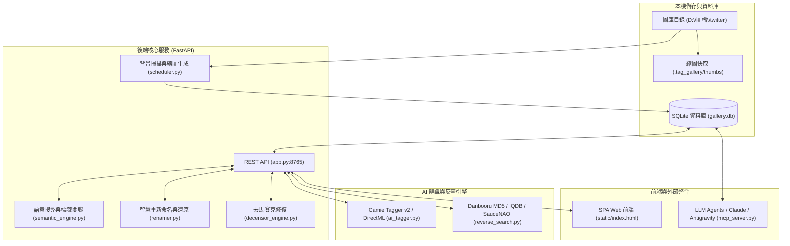

# Twitter & Pixiv AI 智慧標籤圖庫系統 (Twitter Tag Gallery)

[](https://www.python.org/)
[](https://fastapi.tiangolo.com)
[](https://onnxruntime.ai/)
[](https://modelcontextprotocol.io/)
[](https://opensource.org/licenses/MIT)

專為本機數萬張 Twitter (X)、Pixiv 與二次元動漫插圖打造的 **高效能 AI 智慧圖庫與標籤管理系統**。

本系統結合了 **FastAPI SPA 現代化 Web 介面**、**本機 AI 視覺標籤打標 (Camie Tagger v2)**、**多來源以圖搜圖與標籤校正 (Danbooru MD5 / IQDB / SauceNAO)**、**語意搜尋與繁體中文在地化**、**安全重命名與智慧歸檔**、**二次元去馬賽克修復**，以及支援 LLM Agent 協作的 **Model Context Protocol (MCP) 伺服器**。

---

## 📑 目錄

- [核心功能特色](#-核心功能特色)
- [系統架構](#-系統架構)
- [專案結構](#-專案結構)
- [快速上手](#-快速上手)
  - [1. 安裝環境與依賴](#1-安裝環境與依賴)
  - [2. 配置圖庫目錄](#2-配置圖庫目錄)
  - [3. 啟動 Web 服務](#3-啟動-web-服務)
- [進階模組說明](#-進階模組說明)
  - [以圖搜圖與標籤校正引擎](#-以圖搜圖與標籤校正引擎-reverse_searchpy)
  - [本機 AI 視覺打標與硬體加速](#-本機-ai-視覺打標與硬體加速-ai_taggerpy)
  - [智慧重命名與一鍵還原](#-智慧重命名與一鍵還原-renamerpy)
  - [MCP Server (AI Agent 整合)](#-mcp-server-ai-agent-整合-mcp_serverpy)
- [授權與免責聲明](#-授權與免責聲明)

---

## ✨ 核心功能特色

### 🖼️ 1. 極速現代化 Web 圖庫介面
- **高效能瀑布流**：針對 30,000+ 張插圖進行虛擬滾動與縮圖快取優化，秒開秒刷。
- **複合標籤檢索**：支援包含（`+tag`）、排除（`-tag`）、多標籤交叉檢索。
- **分類導航**：將標籤分為「畫師 (Artist)」、「角色 (Character)」、「原作作品 (Copyright)」、「外貌/服裝/屬性 (General)」、「主題 (Theme)」等分類。
- **鍵盤快捷瀏覽**：支援左右箭頭換頁、空格鍵縮放、Esc 退出與快捷標籤操作。
- **一鍵畫師歸檔**：點擊畫師標籤即可建立專屬資料夾並將圖片自動移入歸檔。

### 🔍 2. 多重以圖搜圖與標籤校正 (Reverse Search & Calibration)
- **Danbooru MD5 精準比對**：無需上傳圖片，計算本地檔案 MD5 直接命中 Danbooru 資料庫，秒級獲取 100% 官方認證之畫師、Twitter `@帳號`、Pixiv ID、角色與完整標籤。
- **IQDB 視覺比對**：對於未完全命中 MD5 的插圖，自動透過 IQDB 多圖庫 (Danbooru / Yande.re / Gelbooru) 比對相似圖。
- **SauceNAO 整合**：精準反查推特推文狀態 URL 與 Fanbox / Fantia 作者。
- **標籤自動校正 (Tag Calibration)**：確認真實畫師後，自動清除本機 AI 低信心度猜錯的畫師與錯誤標籤。

### 🧠 3. 本機 AI 視覺辨識引擎 (AI Vision Tagger)
- **Camie Tagger v2 / WD14 ONNX 模型**：內建 70,527+ 標籤與 7,007+ 位二次元繪師風格辨識能力。
- **硬體加速支援**：原生支援 Windows DirectML (AMD Radeon RX 系列顯卡) 與 NVIDIA CUDA 加速。
- **Pixiv 原生解析**：針對檔名包含 Pixiv ID 的圖片，直接解析作品並取得原作者資訊。
- **高效批次打標**：提供平行加速多執行緒打標指令碼 (`fast_bulk_artist_tagger.py`)。

### 🌐 4. 語意搜尋與繁體中文在地化
- **雙語字典映射**：內建 Danbooru 英文標籤轉繁體中文對照字典 (`zh_dict.py`)。
- **語意概念搜尋**：輸入「黑絲」、「泳裝海灘」等自然語言概念，系統自動展開關聯標籤進行多維度圖片推薦。
- **共現相關性矩陣**：計算標籤之間的 Jaccard 相似度與條件機率 $P(B|A)$。

### 📁 5. 智慧重命名與交易安全還原 (Safe Renamer & Undo)
- **Windows 自然排序編號**：支援將混亂的隨機檔名或推特截圖標準化為 `YYYYMMDD_001.ext`。
- **完整交易日誌**：每次重新命名操作均記錄於 JSON 日誌中，支援一鍵批次還原 (Undo)。

### 🎨 6. 二次元去馬賽克修復引擎 (Decensor Engine)
- **YOLOv8 遮罩偵測**：自動鎖定二次元馬賽克部位。
- **DeepCreamPy v2 ONNX 局部重繪**：透過本機神經網路進行細緻影像修復，支援 DirectML 顯卡記憶體一鍵釋放。

### 🤖 7. Model Context Protocol (MCP) 伺服器
- 內建標準 MCP 伺服器 (`mcp_server.py`)，可無縫連接 Claude Desktop、Gemini Flash 或 Antigravity Agent。
- 提供 10+ 個 AI 工具，支援 Agent 自動分析圖庫標籤相關性、翻譯未翻譯標籤與執行深度校正。

---

## 🏛️ 系統架構



---

## 📂 專案結構

```text
twitter-tag-gallery/
├── app.py                         # FastAPI 主要 Web 服務與 API 路由
├── database.py                    # SQLite 資料庫連線、Schema 與底層掃描邏輯
├── ai_tagger.py                   # 本機 ONNX 視覺打標引擎 (Camie Tagger v2)
├── reverse_search.py              # 以圖搜圖 (Danbooru MD5, IQDB, SauceNAO)
├── fast_bulk_artist_tagger.py     # 高速批次畫師分類與平行打標工具
├── parallel_artist_tagger.py      # 多執行緒畫師標籤處理工具
├── semantic_engine.py             # 標籤相關性 (Jaccard) 計算與語意搜尋展開
├── zh_dict.py                     # Danbooru 標籤繁體中文翻譯字典與資料夾映射
├── build_full_enrichments.py      # 標籤繁中字典與高階主題叢集建置腳本
├── renamer.py                     # 安全檔案批次重命名與 1 鍵還原系統
├── decensor_engine.py             # YOLOv8 遮罩偵測 + DeepCreamPy v2 局部修復
├── scheduler.py                   # 背景監控與增量掃描排程器
├── mcp_server.py                  # Model Context Protocol (MCP) 伺服器
├── requirements.txt               # Python 依賴清單
├── static/
│   └── index.html                 # 現代化單頁 Web 圖庫前端 (SPA)
├── run_gallery.bat                # 啟動 Web 服務捷徑腳本
├── stop_gallery.bat               # 停止背景服務腳本
├── start_background.pyw           # 背景無終端機視窗靜默啟動器
└── start_silent.vbs               # VBScript 靜默啟動包裝
```

---

## 🚀 快速上手

### 1. 安裝環境與依賴

確保本機已安裝 **Python 3.10 或以上版本**：

```bash
git clone https://github.com/tsukiamaoto/twitter-tag-gallery.git
cd twitter-tag-gallery

# 建立並啟用虛擬環境 (建議)
python -m venv venv
venv\Scripts\activate

# 安裝核心依賴
pip install -r requirements.txt
```

> **DirectML 硬體加速（AMD GPU 專用）**：
> 若使用 AMD 顯示卡進行 AI 模型推論加速，請安裝：
> ```bash
> pip install onnxruntime-directml
> ```

### 2. 配置圖庫目錄

在 [`database.py`](file:///h:/code/twitter-tag-gallery/database.py#L12) 中設定您的圖片庫所在路徑：

```python
# database.py
GALLERY_ROOT = Path(r"D:\圖檔\twitter")  # 請替換為您的本地圖片目錄
```

系統啟動時會在該目錄下自動建立 `.tag_gallery/` 資料夾，儲存 SQLite 資料庫 (`gallery.db`)、縮圖快取與 AI 模型。

### 3. 啟動 Web 服務

直接執行啟動腳本或透過 Python 執行：

```bash
# 方式 A：直接執行 Python
python app.py

# 方式 B：使用批次檔背景啟動 (Windows)
run_gallery.bat
```

開啟瀏覽器造訪：**[http://127.0.0.1:8765](http://127.0.0.1:8765)**

---

## 🛠️ 進階模組說明

### 🔍 以圖搜圖與標籤校正引擎 (`reverse_search.py`)
- 當圖庫中部分圖片由本機 AI 猜測的信心度較低時，可使用以圖搜圖工具：
  - 計算本地圖片 MD5 直接向 Danbooru 請求查詢，無須耗費頻寬上傳完整圖檔。
  - 自動抽取 Pixiv Artwork ID、Twitter 貼文 ID、Fanbox 作者與原作角色資訊。
  - 一旦取得權威資料，自動清除誤判標籤並更新至資料庫。

### 🧠 本機 AI 視覺打標與硬體加速 (`ai_tagger.py`)
- 首次掃描或新增大量圖片時，可調用批次打標腳本：
  ```bash
  python fast_bulk_artist_tagger.py
  ```
- 支援動態切換 CPU / DirectML / CUDA 執行提供者，兼具辨識精準度與記憶體釋放控制。

### 📁 智慧重命名與一鍵還原 (`renamer.py`)
- 將特定繪師資料夾內的檔案依照自然日期與序號規範化：
  - 格式範例：`20240501_001.png`、`20240501_002.jpg`。
  - 執行前可透過 API 或前端預覽變更計畫，每次重命名皆保留交易 Log，支援錯誤操作時一鍵 Undo 復原。

### 🤖 MCP Server (AI Agent 整合) (`mcp_server.py`)
Twitter Tag Gallery 實作了 **Model Context Protocol (MCP)**，可供 Claude Desktop 或 Antigravity 代理呼叫。

在 Claude Desktop 或 Antigravity 設定檔中加入：

```json
{
  "mcpServers": {
    "twitter-tag-gallery": {
      "command": "python",
      "args": ["H:\\code\\twitter-tag-gallery\\mcp_server.py"]
    }
  }
}
```

**支援的 MCP 工具**：
- `gallery_get_overview`：圖庫總量、畫師分佈與標籤統計。
- `gallery_find_tag_correlations`：查詢標籤共現性與 Jaccard 關聯度。
- `gallery_semantic_search`：自然語言展開之語意搜尋。
- `gallery_list_untranslated_tags`：列出待翻譯標籤供 LLM 批次處理。
- `gallery_apply_gemini_enrichments`：批次寫入繁中翻譯與高階主題分類群組。
- `gallery_deep_reverse_search_batch`：深度以圖搜圖與標籤校正。

---

## 📄 授權與免責聲明

- 本專案採用 **[MIT License](LICENSE)** 授權。
- 本軟體僅供個人本地圖片整理與學術研究用途。請遵守相關網站（Twitter / Pixiv / Danbooru / SauceNAO）之使用條款與版權規範。
