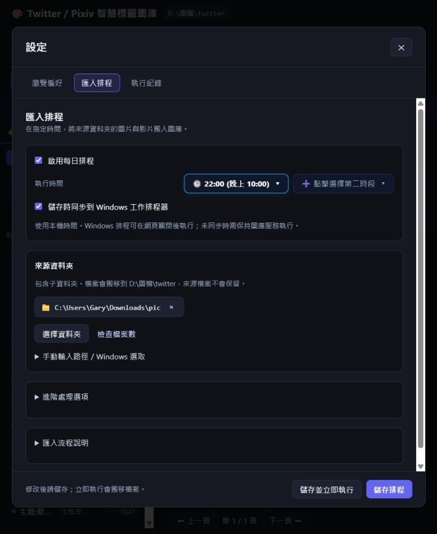

# 002 — 設定中心與排程簡化

狀態：done  
開始日期：2026-10-20  
完成日期：2026-10-20

## 目標

主畫面加入「設定」入口，將排程歸入設定中心。提供瀏覽偏好、匯入排程、執行紀錄；常用設定優先，長說明及進階處理細節收合。保留原有排程 API 與儲存方式。

## 驗收

- [x] 主畫面以設定入口取代獨立彩色排程按鈕。
- [x] 排程基本畫面保留啟用、時間與來源資料夾。
- [x] 進階處理選項與說明可展開，紀錄有獨立區域。
- [x] 儲存與立即執行清楚分開，錯誤有回饋。
- [x] 窄畫面可捲動、關閉；鍵盤焦點及 Escape 可操作。
- [x] 不為驗收而啟動真實搬移或修改 Windows 排程。

## 驗證結果

- 在本機 WebUI 實際確認「瀏覽偏好／匯入排程／執行紀錄」切換、既有設定載入、進階選項展開及紀錄空狀態。
- 在約 738 × 900 的瀏覽器視窗確認內容可捲動、底部操作可見；設定頁籤可用左右鍵切換，Shift+Tab 可循環焦點。
- 儲存成功／失敗、隱藏參數保留、儲存失敗不啟動任務、更新紀錄不覆寫未儲存表單，使用隔離測試驗證。
- `node --test tests/webui.test.cjs`：10 項通過。
- 限制：未對真實排程送出儲存或立即執行請求，未觸發搬移或改寫 Windows 工作排程器。沒有以實際搬移結果作為本次 UI 驗收證據。
